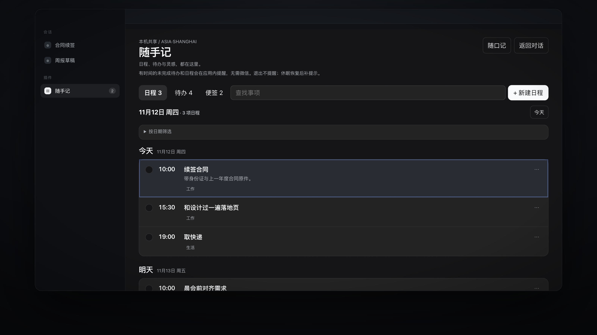

<div align="center">

# 随手记

**Turn one sentence in a conversation into a dated item on your own machine.**

[](LICENSE)
[](https://github.com/deepseek-ai)
[](README.md)

**English** · [简体中文](README.md)

</div>

A local calendar plugin for [DeepSeek Harness](https://github.com/deepseek-ai): notes, todos and dated events share one ledger. It reminds you in the app when something is due, and can also send that reminder to WeChat if you have confirmed a target.

> The plugin's display name is **随手记**; the repository and package name is `dsh-quickjot`. They are the same thing — a Chinese name for daily use, an ASCII identifier for config files and code.

[](https://github.com/spankingsnail/dsh-quickjot/raw/main/docs/promo/dsh-quickjot-promo.mp4)

<p align="center"><sub>▶ 45-second demo (silent, Chinese subtitles, 2.8 MB). Every item in the footage is fictional.</sub></p>

Everything lives on your machine as one JSON record per item: readable, backup-able, portable.

The WeChat part is not our own work: target management and the message channel come from **[DSH-IM](https://github.com/xmanrui/dsh-im)**. Without it, reminders would stop at the in-app list.

---

## Why it exists

Most of what you think out loud with an assistant is gone the moment the answer lands.

"Remind me to renew the contract at ten tomorrow", "note this idea down", "finish the proposal before next Wednesday" — those sentences dissolve into the transcript. What you need is not a smarter assistant but **a place where a sentence becomes an item**.

That place is 随手记:

- Say it in any conversation; the agent writes the item into the local ledger through the plugin's tools.
- Open the sidebar and see it: the calendar lists events by month, todos can be checked off, notes keep the ideas that have not crystallised yet.
- When it is due, it reminds you — in-app reminders need no setup at all; WeChat reminders need a target you have saved beforehand.

What it deliberately does **not** do: it does not read or listen to your other conversations, does not act on todos by itself, does not infer authorisation from quoted material, does not upload anything, and does not make decisions for you.

## Three ways in

| Entry | Good for | Notes |
| --- | --- | --- |
| Sidebar **随手记** | Manual tidy-up, browsing the calendar | Event / todo / note views; expand the month grid to filter by date |
| Asking in chat | Recording while you work | The `dsh_quickjot_list` / `dsh_quickjot_write` tools |
| In-page **随口记** | When you do not want to switch pages | A short chat on your DSH model quota; items land in the same ledger |

The UI follows the DSH theme. Dates and due times are always read as **Asia/Shanghai**, never the browser time zone.

## Design decisions you will notice

**Speaking is the entry point.** The "new item" form is a fallback. Open the page, open 随口记, and say "meeting at ten tomorrow morning" — the assistant splits it into items and asks about anything vague. When the time is unclear it asks first instead of guessing.

**Quoting is not authorisation.** Articles you paste, meeting notes, other people's words are all just material. An item is created only when you explicitly ask for it. That rule lives in the plugin's global policy, not in the model's mood of the moment.

**Per-item writes can partially succeed.** When you write several items at once, each one lands independently under a revision-based optimistic lock. There is no whole-table overwrite, and a failed second item is never dressed up as "all good" — you get the reason per item.

**Reminder state is verifiable.** Before a WeChat send, the plugin persists "sending"; only a channel acknowledgement becomes "sent"; a timeout or crash becomes "uncertain" with **no automatic retry**, so you are never spammed twice. Check WeChat, then decide whether to resend.

**It does not pretend to be reliable.** Quitting the app stops reminders; real sleep defers delivery and produces a "missed reminder" afterwards. This is a best-effort local reminder, not a precision alarm clock — the README says so up front, because promising what cannot be delivered is worse than not promising.

## Install

> Currently v2.1.0, for the desktop build of DSH (0.2.x). Once listed on dshmarket, the easiest path is to search for **随手记** in the plugin market.

Manual:

```bash
git clone https://github.com/spankingsnail/dsh-quickjot.git ~/dsh-quickjot
cd ~/dsh-quickjot
npm install
npm run build
```

Then register this checkout in your DSH profile (`~/.dsh/profiles/<profile>/package.json`):

```json
{
  "dependencies": {
    "dsh-quickjot": "link:/Users/you/dsh-quickjot"
  },
  "dsh": {
    "profile": {
      "bundles": ["...other bundles...", "dsh-quickjot"]
    }
  }
}
```

Run `pnpm install` inside that profile directory and restart DSH. The sidebar showing **随手记** means it loaded. You can disable or remove the plugin at any time; disabling does not delete existing items.

## Using it

**In chat:**

- "Note an idea: add a risk column to the weekly report"
- "Remind me to renew the contract at ten tomorrow morning"
- "What is on my schedule this week?"
- "Mark 'renew contract' as done"

**In the page:** click "+ New note / todo / event", or just say it in 随口记. Notes and plain todos may have no date; an event must have a concrete date and time.

**Reminders:** unfinished todos and events with a time enter the in-app reminder list automatically — the "Reminders N" button at the bottom right opens the unread list, popping at most three at the moment they come due. To also send some reminders to WeChat, first test and save a target under Settings → IM bot → WeChat, then select it as the default in the page.

## Data and privacy

- Items live in the DSH storage domain `dsh_quickjot` (version 1, one record each); unread reminder state lives in `dsh_quickjot_in_app`. The backend is plain per-record JSON at a path DSH decides (usually under `~/.dsh/storages/`).
- Only items, tags, reminder state and the ID of the delivery target you picked are stored. No conversation content, no address book, no WeChat token.
- WeChat delivery only calls a target **you have already saved** through the connected `dshIm` service. It never creates targets, reads credentials, or messages unknown contacts.
- Everything is local: no server, no cloud sync, no external data source.

## Where it comes from

This plugin started as a larger prototype: besides notes, todos, events and reminders it carried text meeting notes (AI summaries plus human-confirmed action conversion) and macOS local recording capture.

v2 removed both. The reason is plain: meetings and recording made the plugin heavy (the recorder plus its build cache approached 200 MB), while the part actually used every day was the three item kinds and the reminders. **Make one thing solid first**; adding the rest back later is still an option.

The full prototype is preserved in git history: [`v1.0.0`](https://github.com/spankingsnail/dsh-quickjot/releases/tag/v1.0.0). Legacy tags such as 会议记录 and 沟通记录 remain because a migration should not lose your data.

### About the name

The early version was called 随手记, it was briefly renamed DSH-Calendar, and now **the display name is 随手记 again while the identifier is `dsh-quickjot`**.

The identifier changed for a concrete reason, not for novelty: `dsh-calendar` is already used by nine repositories on GitHub, and on npm the name belongs to a different project (`dsh-calendar`, 7k+ downloads a month). Keeping it would guarantee that this plugin ranks behind all of them, and that anyone running `npm i dsh-calendar` installs the wrong thing.

`jot` means exactly what 随手记 means — to write something down offhand — and it collides with nothing in the DSH plugin space. The Chinese display name never needed fixing, so it stayed.

> Upgrading from an older version: the storage domains are now `dsh_quickjot` / `dsh_quickjot_in_app`, and the tools are `dsh_quickjot_list` / `dsh_quickjot_write` / `dsh_quickjot_in_app_reminders`. Data was copied over as-is; the old directories were not deleted.

## Credits

- **[DSH-IM](https://github.com/xmanrui/dsh-im)** (`@xmanrui/dsh-im`) — **the WeChat delivery in this plugin exists only because of its technology.** Target management, the IM channel and send receipts all come from DSH-IM; 随手记 adds only three things on top: picking one of your saved targets, recording delivery state locally, and letting you verify the result. No DSH-IM, no WeChat reminders.
- **[dsh-plugin-control-your-schedule](https://github.com/HaoyanZhang123/dsh-plugin-control-your-schedule)** (HaoyanZhang123, MIT) — the upstream this project grew out of. The data shape, the reminder state machine and the "quoting is not authorisation" policy are continued from it.
- **[DeepSeek Harness](https://github.com/deepseek-ai)** — plugin framework, UI slots, storage domains and model quota.

## License

MIT. Upstream copyright and provenance are retained; see [THIRD_PARTY_NOTICES.md](THIRD_PARTY_NOTICES.md).
