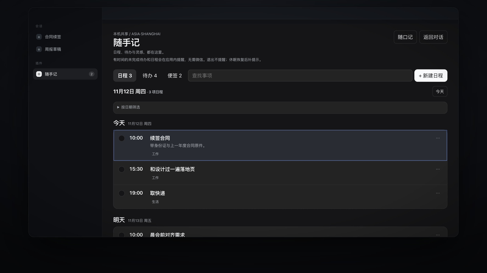

<div align="center">

# 随手记

**把对话里的一句话，落成本机上的一个日程。**

[](LICENSE)
[](https://github.com/deepseek-ai)
[](README.en.md)

[English](README.en.md) · **简体中文**

</div>

一个给 [DeepSeek Harness](https://github.com/deepseek-ai) 用的本机日历插件：**便签、待办、日程**三种形态共用一本账；到期时在应用里提醒你，按你的确认也可以发到微信。

> 插件显示名是**随手记**，仓库与包名是 `dsh-quickjot`。两者指的是同一个东西：中文名字给日常使用，英文标识给配置文件和代码。

[](https://github.com/spankingsnail/dsh-quickjot/raw/main/docs/promo/dsh-quickjot-promo.mp4)

<p align="center"><sub>▶ 45 秒演示（无声，中文字幕，2.8MB）。画面里的数据全部是虚构的。</sub></p>

数据存在你自己的机器上，逐条 JSON，随时能看、能备份、能带走。

微信推送那一段不是自己实现的：目标管理与消息通道来自 **[DSH-IM](https://github.com/xmanrui/dsh-im)**，没有它，提醒只会停在应用内。

---

## 为什么需要它

你和 AI 聊出来的东西，大多数都不会被记住。

「明天十点提醒我续签合同」「这个想法先记下来」「下周三之前把方案写完」——这些话说完就消失在对话流里。你需要的不是更聪明的助手，而是一个**把话变成事项**的地方。

随手记就是这个落点：

- 在任意对话里说一句，Agent 用插件提供的工具把事项写进本机账本；
- 侧栏打开就能看到，日历按月列出日程，待办可以勾掉，便签留给还没成形的想法；
- 到期了它会提醒你——应用内提醒不需要任何额外配置，微信提醒需要你事先选好收件目标。

它刻意**不做**几件事：不读取或监听其他对话，不自动执行待办，不从引用和讨论里推断你的授权，不上传内容，不替你做决定。

## 三个入口

| 入口 | 适合 | 说明 |
| --- | --- | --- |
| 侧栏「随手记」 | 手动整理、翻日历 | 日程 / 待办 / 便签三个视图，月历可展开按日期筛选 |
| 对话提问 | 一边干活一边记 | `dsh_quickjot_list` / `dsh_quickjot_write` 两个工具 |
| 页面内「随口记」 | 不想切页面时 | 一段短对话，走 DSH 的模型额度，记录仍落在同一本账 |

界面跟随 DSH 主题；日程与截止时间一律按 **Asia/Shanghai** 解释，不跟随浏览器时区。

## 你会注意到的几个设计取舍

**「说一句」才是入口。** 新建表单只是兜底。打开页面、点开「随口记」，都可以直接说「明天上午十点开会」，助手会拆成事项并追问含糊的地方；时间不明确时它先问，不猜。

**引用不是授权。** 你贴进来的文章、会议记录、别人的话，都只是资料。只有你自己明确要求记录，才会建项。这条写在插件的全局策略里，不靠模型的临场判断。

**逐项保存，可能部分成功。** 一次写多条时，每条独立落盘并带 revision 乐观锁。不会整表覆盖，也不会把「第二条失败」粉饰成「全部成功」——失败的会逐条告诉你原因。

**提醒状态是可核对的。** 微信发送前先持久化「发送中」，渠道确认后才记「已发送」；超时或崩溃记「不确定」，**不自动重试**，避免重复打扰。你可以核对微信后自己决定要不要重发。

**它不会假装可靠。** 应用退出不提醒；真正睡眠时不能准点发送，恢复后会补一条「错过的提醒」。这不是精确闹钟，是尽力而为的本机提醒——README 把这句话写在显眼处，因为承诺做不到的事比不做更糟。

## 安装

> 当前为 v2.1.0，面向桌面版 DSH（0.2.x）。上架 dshmarket 后，最省事的方式是在插件市场里搜索 **随手记** 直接安装。

手动安装：

```bash
git clone https://github.com/spankingsnail/dsh-quickjot.git ~/dsh-quickjot
cd ~/dsh-quickjot
npm install
npm run build
```

然后把本仓库登记进你的 DSH profile（`~/.dsh/profiles/<profile>/package.json`）：

```json
{
  "dependencies": {
    "dsh-quickjot": "link:/Users/you/dsh-quickjot"
  },
  "dsh": {
    "profile": {
      "bundles": ["...其他 bundle...", "dsh-quickjot"]
    }
  }
}
```

在该 profile 目录执行 `pnpm install`，重启 DSH。侧栏出现「随手记」即安装成功。插件可随时停用或卸载，停用不会删除已有事项。

## 使用

**在对话里：**

- 「帮我记个想法：给周报加一栏风险」
- 「明天上午十点提醒我续签合同」
- 「这周还有什么日程？」
- 「把『续签合同』标成完成」

**在页面里：** 点「+ 新建便签 / 待办 / 日程」，或直接在「随口记」里说。便签和普通待办可以没有日期；日程必须有具体日期和时分。

**提醒：** 有时间的未完成待办和日程会自动进入应用内提醒——右下角「提醒 N」打开未读列表，到期时最多弹 3 条。想让某些提醒也发到微信，先在「设置 → IM机器人 → 微信」测试并保存目标，再在页面里选为默认。

## 数据与隐私

- 事项在 DSH 的存储域 `dsh_quickjot`（version 1，逐条记录）；提醒未读状态在 `dsh_quickjot_in_app`。后端是逐条 JSON 文件，路径由 DSH 决定（本机通常在 `~/.dsh/storages/` 下）。
- 只保存事项、标签、提醒状态和你选定的收件目标 ID；不保存对话内容、通讯录、微信 token。
- 微信投递只调用已接入的 `dshIm` 服务里**你已经保存过的**目标，不创建目标、不读取凭据、不主动给未知联系人发消息。
- 所有功能都在本机；没有服务器、没有云同步、不调用外部数据源。

## 它的来历

这个插件的前身是一个更大的原型：除了便签、待办、日程和提醒，还带文字会议整理（AI 纪要 + 人工确认的行动转换）与 macOS 本地录音采集。

v2 把它们拿掉了。原因很实在：会议和录音让插件变得很重（录音组件连同构建缓存接近 200MB），而真正每天在用的部分，是那三种事项和提醒。**先把一件事做利落**，再加回来也不迟。

完整原型保留在 git 历史里：[`v1.0.0`](https://github.com/spankingsnail/dsh-quickjot/releases/tag/v1.0.0)。标签仍沿用「会议记录」「沟通记录」等旧分类，因为迁移不该弄丢你的数据。

### 关于名字

早期叫「随手记」，中间一度改叫 DSH-Calendar，现在**显示名回到「随手记」，标识符改成 `dsh-quickjot`**。

改标识符不是为了新鲜，是因为 `dsh-calendar` 这个名字在 GitHub 上已经有 9 个同名仓库，npm 上还被别人占了（`dsh-calendar` 是另一个项目在发布，月下载七千多）。叫这个名字，等于永远排在搜索结果第九位以后，还会让 `npm i dsh-calendar` 的人装错东西。

`jot` 就是「随手记下」，和中文名对得上，也不和任何现存 DSH 插件冲突。中文名「随手记」没有动，因为它本来就是干净的。

> 从旧版本升级：存储域已迁移到 `dsh_quickjot` / `dsh_quickjot_in_app`，工具名改为 `dsh_quickjot_list` / `dsh_quickjot_write` / `dsh_quickjot_in_app_reminders`。数据是原样复制过去的，旧目录没有删。

## 致谢

- **[DSH-IM](https://github.com/xmanrui/dsh-im)**（`@xmanrui/dsh-im`）——**这个插件的微信推送，完全是借它的技术才做到的**。目标管理、IM 投递通道和发送回执都由 DSH-IM 提供；随手记只在它之上做三件事：从你已经保存的目标里选一个、把发送状态记进本机、让你能核对结果。没有 DSH-IM，就不会有「微信提醒」这个功能。
- **[dsh-plugin-control-your-schedule](https://github.com/HaoyanZhang123/dsh-plugin-control-your-schedule)**（HaoyanZhang123，MIT）——本项目的上游。数据结构、提醒状态机和「引用不是授权」的策略延续自它。
- **[DeepSeek Harness](https://github.com/deepseek-ai)**——插件框架、UI 插槽、存储域与模型额度。
- Zod（MIT）是唯一声明的运行时依赖；React 来自 DSH 的模块表。

## License

MIT。保留上游版权与来源说明，见 [THIRD_PARTY_NOTICES.md](THIRD_PARTY_NOTICES.md)。
